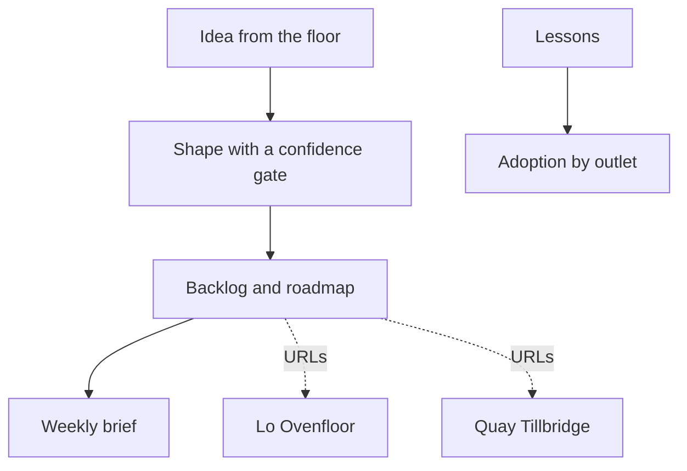

# Architecture — Lộ Trình Hub

Portfolio hub for backlog, roadmap, leadership brief, training, and adoption. Own Neon database; links to Ovenfloor and Tillbridge by public URL only.

## Request flow

1. UI reads Postgres via Prisma (`force-dynamic` pages).
2. Mutations hit `/api/*` routes that re-read the demo role cookie and enforce `src/server/access.ts`.
3. AI routes call `src/lib/ai/client.ts`, which uses fixtures when `AI_DEMO_MODE=auto` and no API key.
4. Domain rules live in `src/server/citations.ts`, `shape-policy.ts`, and `adoption.ts` with tests in `tests/`.

## Trust boundaries

- The model proposes shaped stories and brief text; citations and confidence gates discard bad output.
- Publish and accept write audit rows and decisions; colleagues cannot publish.
- Adoption percentages exclude kitchen staff and non-colleague roles.

See root planning `ARCHITECTURE.md` for the three-app topology and shared fictional catalogue.
