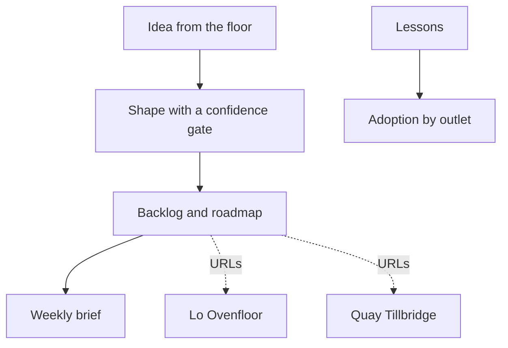

# SPEC — Lộ Trình Hub

Portfolio demonstration for the Sharon JSC AI Implementation Specialist role. Not an official Sharon system.

Product name on screen: **Lộ trình**. Kicker: `PROGRAMME · PORTFOLIO`.

## Product vision

This is the specialist’s working board for a demo bakery group. Colleagues drop ideas in Vietnamese. A shaper turns a specific idea into a story and leaves a vague one in the inbox. The director publishes a weekly brief that can only cite work that exists. Training completion shows whether an outlet is ready for the floor tool. The hub links out to Lò Ovenfloor and Quầy Tillbridge. It does not copy their databases.

## Personas

| Persona | Role cookie | Need |
| --- | --- | --- |
| Bảo Nguyễn and other colleagues | `colleague` | Submit an idea, take the lessons, read a published brief. |
| Lan Phạm | `colleague` | Submit the waste-photo idea from the kitchen. She is not a counter adoption statistic. |
| Trâm Bùi, trainer | `trainer` | See who finished, by name, and which outlet is behind. |
| Ánh Đặng, director | `sponsor` | Move stages, publish the brief, read baker and finance versions. |

| Action | colleague | trainer | sponsor |
| --- | --- | --- | --- |
| Submit an idea | yes | yes | yes |
| Shape an idea (runs the model) | no | yes | yes |
| Accept a shaped idea onto the board | no | yes | yes |
| Move stage | no | no | yes |
| Draft a brief | no | yes | yes |
| Publish a brief | no | no | yes |
| Take a lesson | yes | yes | yes |
| See completion names | no | yes | yes |
| See outlet percentages | yes | yes | yes |

## User stories

1. As Ánh, I open the week of 2–8 Nov 2026 and see what is already released versus still in test.
2. As Ánh, I open a released card and reach the Ovenfloor or Tillbridge demo.
3. As Bảo, I submit `dùng AI cho bánh` and, after a trainer shapes it, it stays in the inbox because it is too vague.
4. As Lan, I submit a specific waste-photo note and a trainer can accept a proper story with acceptance criteria.
5. As Trâm, I see Nguyễn Huệ at 80%, Thảo Điền at 50%, and Phú Mỹ Hưng at 0%.
6. As Ánh, I draft a brief and the page rejects it if a bullet cites an id that is not on the board.
7. As a head baker reading with Ánh, I switch the brief to the baker version and the finance version.
8. As Bảo, I cannot publish.
9. As a colleague, I complete three short lessons and my outlet percentage can change.
10. As Ánh, I read the roadmap as Now, Next, and Later without a separate methodology lecture.

## Board facts

Week start **2026-11-02** (Monday) through **2026-11-08**.

Seed these work items:

| ID | Area | Stage | Title | Source |
| --- | --- | --- | --- | --- |
| `LT-01` | mfg | released | Batch plan the night before | `OF-R01` |
| `LT-02` | finance | released | Reconcile transfer lines without posting from chat | `QT-R03` |
| `LT-03` | ops | test | Floor tablet for waste reasons | `OF-R05` |
| `LT-04` | sales | prototype | Gift-box order to invoice draft | `QT-R01` |
| `LT-06` | cross | shaped | Vietnamese explanation on every AI screen | |
| `LT-07` | ops | parked | A second kitchen | |
| `LT-08` | sales | inbox | Loyalty stamps | |

Do not seed `LT-05`. The photo idea becomes a new item only if a person accepts it during the demo. New ids use the next `LT-` integer.

RICE numbers are null in the seed. A person may set them. The shaper must leave `impact_vnd` null and must not write a đồng amount.

Ideas:

| ID | Author | Body | Expected shape |
| --- | --- | --- | --- |
| `idea-vague` | `bao` | `dùng AI cho bánh` | confidence below **0.4**, stays `new` / inbox, no work item |
| `idea-photo` | `lan` | `Cuối ngày tủ mát còn bánh mì pate, chụp ảnh và ghi lý do hao hụt mất 10 phút. Muốn một nút: chụp, chọn lý do, xong.` | confidence **0.8**, area `ops`, three acceptance criteria, waiting for a human to accept |

The photo story’s acceptance criteria must include: a fixed reason list, a same-day record, and no automatic change to the batch quantity. That keeps the idea consistent with Ovenfloor.

Adoption, colleagues only (trainers and the sponsor are excluded from the denominator):

| Outlet | People | Finished all 3 modules | Rate |
| --- | --- | --- | --- |
| `CTR-NH` | Thảo, Đức, My, Phong, Chi (`thao` `duc` `my` `phong` `chi`) | first four finished, Chi has not | 80% |
| `CTR-TD` | Hùng, Vy (`hung` `vy`) | Hùng finished, Vy has not | 50% |
| `CTR-PMH` | Bảo, Kiệt (`bao` `kiet`) | neither finished; Kiệt has completed 1 of 3 | 0% |

Lan (`lan`) is `KIT-D3` and is not on this chart. Trâm (`tram`) is the trainer. Ánh (`anh`) is the sponsor.

Lessons, pass mark **2 of 3** correct:

| Module | Teaches |
| --- | --- |
| `mod-oven` | The night quantity comes from the plan function. The model explains it. |
| `mod-vat` | VAT is computed in code. The model must not be asked for the tax. |
| `mod-idea` | An idea needs the place, the pain, and the finished moment. “Use AI” is not enough. |

Write the questions in both languages in the seed. Three questions each. Answers are obvious from the lesson text. This is a portfolio lesson, not a trick exam.

`LT-01` stores the Ovenfloor URL from `NEXT_PUBLIC_OVENFLOOR_URL`. `LT-02` stores `NEXT_PUBLIC_TILLBRIDGE_URL`. When the env var is empty, the card still renders and the link reads `Demo URL not set yet`.

## Stages and roadmap

| Stage | Roadmap column |
| --- | --- |
| `released` | Now |
| `test`, `prototype` | Next |
| `shaped`, `inbox` | Later |
| `parked` | a side list, not Now / Next / Later |

Home shows counts for the week and the three outlet rates.

## Shaping and briefing rules

Shape schema:

```ts
{
  title: string
  area: "ops" | "finance" | "mfg" | "sales" | "cross"
  story_en: string
  story_vi: string
  acceptance: [string, string, string]
  confidence: number
  missing_info: string[]
}
```

If `confidence < 0.4`, persist the attempt on the idea (`status` stays `new`) and do not create a work item. The UI says the note is too vague to shape. Demo fixture for `idea-vague` returns confidence `0.2` and `missing_info` that asks for the place and the pain.

If the model output contains a `₫` amount or a VND integer and the idea text had none, discard it, use the fixture, flag `INVENTED_IMPACT`.

Accepting a shaped idea creates a work item at stage `shaped` and sets the idea status to `shaped`. That action is trainer or sponsor.

Brief schema:

```ts
{
  bullets: { text_en: string, text_vi: string, cites: string[] }[]
  risks_en: string
  risks_vi: string
  asks_en: string
  asks_vi: string
  baker_en: string
  baker_vi: string
  finance_en: string
  finance_vi: string
}
```

Exactly **5** bullets. `assertCitations` checks every id in `cites` and every `LT-` token in the text against the ids passed in. A failure discards the model output and uses the fixture with `BAD_CITATION`. The fixture cites only `LT-01`, `LT-02`, and `LT-03`.

Publish copies the current draft to status `published` and writes a decision row. Sponsor only. Colleague and trainer receive 403. A published brief is what colleagues see. Drafts are visible to trainer and sponsor.

The baker version talks about trays, waste, and training at the outlet. The finance version talks about invoices and unmatched transfers. Neither version may introduce a work item id outside the five bullets.

## Screens

| Route | Purpose |
| --- | --- |
| `/` | Headline `Tuần này lãnh đạo cần thấy gì` / `What leadership can see this week`. Sub `Tuần 2–8 tháng 11, 2026`. Counts, outlet rates, links to the two demos. |
| `/backlog` | Filter by area and stage. |
| `/roadmap` | Now, Next, Later, Parked. |
| `/ideas` | Inbox and the shape / accept buttons. |
| `/report` | Draft, citations, baker / finance toggle, publish. |
| `/training` | Three modules and the quiz. |
| `/training/[id]` | Lesson and submit. |
| `/adoption` | Outlet rates for everyone. Names for trainer and sponsor. |
| `/trust` | Vague ideas, invented impact, bad citations, demo mode, and the line that completion is not an HR score. |

Same visual tokens as the other apps. Wordmark **Lộ trình**. Default locale `vi`.

## Tech stack

Next.js App Router, TypeScript, Tailwind, Prisma, Neon, Vercel AI SDK, Zod, `tsx --test`. No shared package with the other apps. No Python service.

## Folder structure

```
projects/lotrinh-hub/
  SPEC.md
  README.md
  SECURITY.md
  ARCHITECTURE.md
  DEMO_URL.txt
  .env.example
  .gitignore
  package.json
  prisma/schema.prisma
  prisma/migrations/
  prisma/seed.ts
  src/app/page.tsx
  src/app/backlog/page.tsx
  src/app/roadmap/page.tsx
  src/app/ideas/page.tsx
  src/app/report/page.tsx
  src/app/training/page.tsx
  src/app/training/[id]/page.tsx
  src/app/adoption/page.tsx
  src/app/trust/page.tsx
  src/app/api/health/route.ts
  src/app/api/session/role/route.ts
  src/app/api/ideas/route.ts
  src/app/api/ideas/[id]/shape/route.ts
  src/app/api/ideas/[id]/accept/route.ts
  src/app/api/work-items/[id]/route.ts
  src/app/api/reports/draft/route.ts
  src/app/api/reports/[id]/publish/route.ts
  src/app/api/training/[id]/complete/route.ts
  src/app/api/adoption/route.ts
  src/components/SiteHeader.tsx
  src/components/DisclaimerFooter.tsx
  src/components/AiModeBanner.tsx
  src/components/TrustPanel.tsx
  src/components/Pipeline.tsx
  src/i18n/en.ts
  src/i18n/vi.ts
  src/lib/db.ts
  src/lib/session.ts
  src/lib/ai/client.ts
  src/lib/ai/demo-fixtures.ts
  src/server/citations.ts
  src/server/shape-policy.ts
  src/server/access.ts
  src/server/adoption.ts
  tests/citations.test.ts
  tests/shape-policy.test.ts
  tests/access.test.ts
```

## SQL schema

```sql
CREATE TABLE person (
  id TEXT PRIMARY KEY,
  name TEXT NOT NULL,
  role TEXT NOT NULL CHECK (role IN ('colleague', 'trainer', 'sponsor')),
  outlet_id TEXT
);

CREATE TABLE work_item (
  id TEXT PRIMARY KEY,
  title TEXT NOT NULL,
  area TEXT NOT NULL CHECK (area IN ('ops', 'finance', 'mfg', 'sales', 'cross')),
  stage TEXT NOT NULL CHECK (stage IN ('inbox', 'shaped', 'prototype', 'test', 'released', 'parked')),
  source_requirement_id TEXT,
  story_en TEXT,
  story_vi TEXT,
  acceptance JSONB,
  rice_reach INT,
  rice_impact INT,
  rice_confidence INT,
  rice_effort INT,
  external_url TEXT,
  updated_at TIMESTAMPTZ NOT NULL DEFAULT now()
);

CREATE TABLE idea (
  id TEXT PRIMARY KEY,
  author_id TEXT NOT NULL REFERENCES person(id),
  body TEXT NOT NULL,
  locale TEXT NOT NULL CHECK (locale IN ('vi', 'en')),
  status TEXT NOT NULL CHECK (status IN ('new', 'shaped', 'declined')),
  confidence NUMERIC,
  missing_info JSONB,
  shaped_json JSONB,
  work_item_id TEXT REFERENCES work_item(id),
  created_at TIMESTAMPTZ NOT NULL DEFAULT now()
);

CREATE TABLE report (
  id TEXT PRIMARY KEY,
  week_start DATE NOT NULL,
  status TEXT NOT NULL CHECK (status IN ('draft', 'published')),
  body JSONB,
  mode TEXT CHECK (mode IN ('demo', 'live', 'fallback')),
  failure_flags TEXT[] NOT NULL DEFAULT '{}',
  published_at TIMESTAMPTZ
);

CREATE TABLE decision (
  id TEXT PRIMARY KEY,
  report_id TEXT NOT NULL REFERENCES report(id),
  text TEXT NOT NULL,
  made_by TEXT NOT NULL,
  at TIMESTAMPTZ NOT NULL DEFAULT now()
);

CREATE TABLE module (
  id TEXT PRIMARY KEY,
  title_en TEXT NOT NULL,
  title_vi TEXT NOT NULL,
  body_en TEXT NOT NULL,
  body_vi TEXT NOT NULL,
  sort_order INT NOT NULL
);

CREATE TABLE question (
  id TEXT PRIMARY KEY,
  module_id TEXT NOT NULL REFERENCES module(id),
  prompt_en TEXT NOT NULL,
  prompt_vi TEXT NOT NULL,
  choices_en JSONB NOT NULL,
  choices_vi JSONB NOT NULL,
  correct_index INT NOT NULL
);

CREATE TABLE completion (
  person_id TEXT NOT NULL REFERENCES person(id),
  module_id TEXT NOT NULL REFERENCES module(id),
  score INT NOT NULL,
  passed BOOLEAN NOT NULL,
  completed_at TIMESTAMPTZ NOT NULL,
  PRIMARY KEY (person_id, module_id)
);

CREATE TABLE audit_event (
  id TEXT PRIMARY KEY,
  at TIMESTAMPTZ NOT NULL DEFAULT now(),
  actor TEXT NOT NULL,
  action TEXT NOT NULL,
  entity TEXT NOT NULL,
  entity_id TEXT NOT NULL,
  detail JSONB NOT NULL
);
```

`adoption.ts` defines “finished” as three passing completion rows. Outlet rate is finished colleagues divided by colleagues at that outlet. Kitchen staff are excluded from the three counter rates.

## API

| Method | Path | Behavior |
| --- | --- | --- |
| GET | `/api/health` | `{ ok, db, ai }` |
| POST | `/api/session/role` | Cookie and audit |
| POST | `/api/ideas` | Any role. Body `{ body, locale }`. Max 1000 characters. |
| POST | `/api/ideas/:id/shape` | Trainer or sponsor. Applies the confidence rule. |
| POST | `/api/ideas/:id/accept` | Trainer or sponsor. 409 if confidence is under 0.4 or missing. Creates the work item. |
| PATCH | `/api/work-items/:id` | Sponsor. Stage changes and optional RICE integers. |
| POST | `/api/reports/draft` | Trainer or sponsor. Replaces the draft body for `2026-11-02`. Runs citation checks. |
| POST | `/api/reports/:id/publish` | Sponsor only. |
| POST | `/api/training/:id/complete` | Body `{ answers: number[] }`. Score and pass mark 2/3. |
| GET | `/api/adoption` | Colleagues receive outlet rates only. Trainer and sponsor also receive names. |

## Security checklist

- Publish, stage changes, and accept are authorized on the server.
- Adoption names are not in the colleague JSON.
- The trust page states that completion is a rollout signal, not a ranking for pay or discipline.
- Briefs cannot cite ids the database did not supply.
- The shaper cannot invent a money impact.
- No live customer data. Staff names are fictional.
- Cookie rules, error shape, rate limit on shape and draft, and `.env.example` match the platform conventions.
- External demo URLs are public links, not embedded admin sessions.

## Acceptance criteria

- Home shows LT-01 and LT-02 as released and the three outlet rates 80 / 50 / 0.
- With the public URLs unset, those cards say the URL is not set. With the env vars set, the links open the other demos.
- Shaping `idea-vague` leaves status `new` and creates no work item.
- Shaping `idea-photo` stores confidence at or above 0.4 in demo mode (0.8) and acceptance lines that protect the batch quantity.
- Accept creates a work item. A colleague calling accept receives 403.
- A brief fixture passes `assertCitations`. A fixture tampered with `LT-99` fails and the draft path stores `BAD_CITATION` and the safe fixture instead.
- Colleague publish is 403. Sponsor publish writes a decision and the colleague-facing page shows the published text.
- `GET /api/adoption` as colleague has rates and no person names. As trainer it includes Chi in the unfinished set.
- Lessons can be completed and a passing score is stored.
- Locale toggle changes the home headline.
- Demo mode banner uses `Chế độ minh hoạ — chưa gọi mô hình` when no key is configured.
- `npm test`, `npm run typecheck`, `npm run lint`, and `npm run build` pass.
- Footer disclaimer on every page.

## Environment

```
DATABASE_URL=
DIRECT_URL=
OPENAI_API_KEY=
OPENAI_BASE_URL=https://api.openai.com/v1
AI_MODEL=gpt-4o-mini
AI_DEMO_MODE=auto
NEXT_PUBLIC_OVENFLOOR_URL=
NEXT_PUBLIC_TILLBRIDGE_URL=
```

Set the two public URLs in Vercel after the other projects deploy. Until then the hub must still be fully usable.

## Seed plan

- People and completions exactly as the adoption table. Passing seed completions use score 3.
- Modules, questions, and lesson bodies in both languages.
- Work items LT-01, LT-02, LT-03, LT-04, LT-06, LT-07, LT-08.
- Ideas `idea-vague` and `idea-photo` at status `new`.
- One report row for week start 2026-11-02 at status `draft` with a null body, so the demo’s Draft button is the first writer.
- No public seed route.

## Demo script (about two minutes)

1. Open the hub. Read the week and the outlet rates. Open LT-01 and LT-02.
2. Switch to English and back.
3. As Bảo’s colleague role, open the vague idea. Switch to Trâm, shape it, and show it staying in the inbox.
4. Shape Lan’s photo idea. Accept it onto the board. Show the acceptance line that says the batch quantity does not move by itself.
5. Draft the weekly brief. Show five bullets with real ids. Toggle baker and finance versions.
6. Publish as Ánh. Switch to a colleague and show publish is gone, while the brief remains.
7. Open training for one question to prove the lesson renders in Vietnamese.

## README, SECURITY, ARCHITECTURE

README sections match the other apps. JD bullets: AI backlog and roadmap; leadership reporting; idea-to-release stages; training and adoption; English and Vietnamese; explaining the same fact to a baker and to finance; links to the operational demos.

Vietnamese disclaimer, verbatim:

> Đây là bản minh hoạ portfolio cho vị trí AI Implementation Specialist tại Sharon JSC. Không phải hệ thống, sản phẩm hay thương hiệu vận hành chính thức của Sharon. Dữ liệu là dữ liệu giả lập cho một bếp bánh demo tại TP.HCM.

App `ARCHITECTURE.md` diagram:


